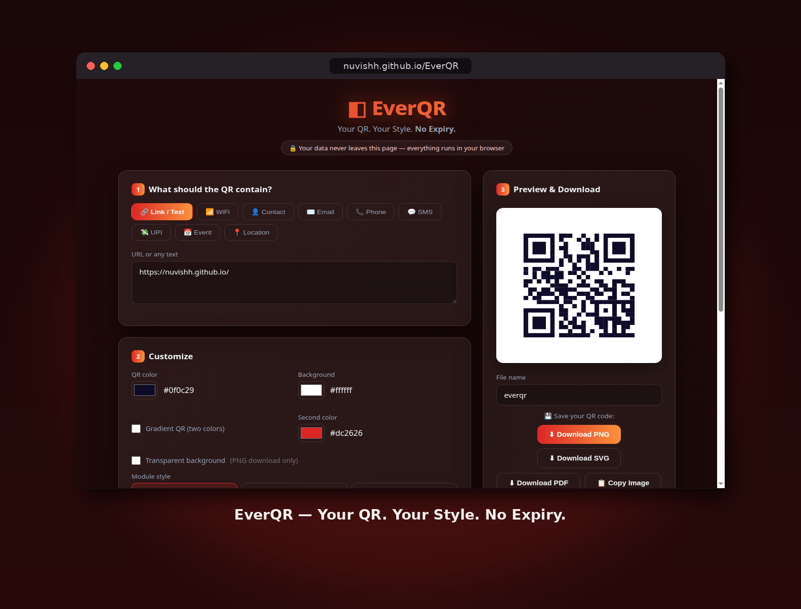

  

# EverQR — Free Static QR Code Generator

*Your QR. Your Style. No Expiry.*

🔗 **Live:** https://nuvishh.github.io/EverQR/

Generate **fully static QR codes that never expire** — customize colors, gradients, module and eye styles, frames, and your own logo, then download as PNG, SVG, or PDF. 100% client-side: your data never leaves the browser.

## Why "never expires"?

Most online QR generators create **dynamic** QR codes — the QR points to *their* server, which redirects to your link. Stop paying (or the service shuts down) and your QR dies.

EverQR generates **static** QR codes: your content is encoded *directly* into the QR image. No servers, no accounts, no redirects — nothing to expire. Ever.

## Content types (9)

- 🔗 **Link / Text** — any URL or plain text
- 📶 **WiFi** — SSID, password, security (WPA / WEP / open), hidden networks
- 👤 **Contact** — vCard (name, phone, email, organization)
- ✉️ **Email** — address, subject, message
- 📞 **Phone** and 💬 **SMS**
- 💸 **UPI payment** — VPA, payee name, optional amount & note (India)
- 📅 **Event** — title, start/end, location, description (calendar-ready)
- 📍 **Location** — latitude / longitude

## Customize

- **Colors** — QR color + background color, or a **two-color gradient** QR
- **Transparent background** option (PNG)
- **Module styles** — square / rounded / dots
- **Eye styles** — 4 corner-eye shapes (square, rounded, circle, leaf)
- **Frames** — Card (“SCAN ME” banner), Bubble (label on top), Tag (ribbon)
- **Center logo** — upload your logo, adjustable size (use Q/H error correction for best scans)
- **Error correction** — L / M / Q / H
- **Margin** — thin / normal / wide
- **Crimson theme** UI — deep red-black with red/orange glows

## Download

- **PNG** — 512 / 1024 / 2048 px
- **SVG** — infinite-scale vector
- **PDF** — print-ready
- **Copy image** to clipboard
- **Custom file name** for every download (default: `everqr`)

## Tech

Single `index.html` + `qrcode.min.js` (qrcode-generator, MIT). Canvas rendering for PNG/PDF, hand-built SVG export. No build step, no dependencies to install, works fully offline after load.

## More free tools by nuvish

- 🗜️ **PixLite** — client-side image compressor — https://nuvishh.github.io/PixLite/
- ⚡ **Beamo Web** — share files browser-to-browser — https://nuvishh.github.io/Beamo-Web/

## Host it

Any static host works — GitHub Pages, Netlify, Vercel, or just open `index.html` locally.

## License

MIT

---

Made with ♥ by **nuvish**
